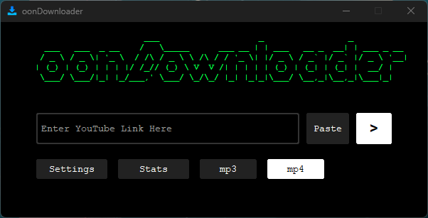

# oonDownloader



A simple desktop app for downloading video and audio, built with Python
and customtkinter. It uses yt-dlp and ffmpeg under the hood and works with
YouTube and many other sites supported by yt-dlp.

## Features
- Download as **mp4** or **mp3**
- Simple download statistics
- Downloads and updates yt-dlp by itself from within the app ("Update yt-dlp")
- Single video links only (playlist and channel links are not supported)
- Supported sites: see the [yt-dlp supported sites list](https://github.com/yt-dlp/yt-dlp/blob/master/supportedsites.md)

## Download
Get the latest `oonDownloader.exe` from the
[Releases page](https://github.com/oppositeofnice/oonDownloader/releases).
You also need ffmpeg, see [Installing ffmpeg](#installing-ffmpeg).

## Installing ffmpeg
ffmpeg is needed for mp3 conversion and for merging video and audio.

**Easiest way (Windows 10/11):** open a terminal and run:
```
winget install Gyan.FFmpeg
```
Then close and reopen the terminal.

**Manual way:**
1. Download a Windows build from [ffmpeg.org](https://ffmpeg.org/download.html)
   and extract it, for example to `C:\ffmpeg`.
2. Add `C:\ffmpeg\bin` to your PATH (Start menu → "Edit the system
   environment variables" → Environment Variables → Path → Edit → New).
3. Open a new terminal and check that `ffmpeg -version` prints a version.

## Run from source
Requirements: Windows, Python 3.10 or newer, and ffmpeg (see above).

1. Clone the repository:
   ```
   git clone https://github.com/oppositeofnice/oonDownloader.git
   cd oonDownloader
   ```
2. Install the dependencies:
   ```
   pip install -r requirements.txt
   ```
3. Run the app:
   ```
   python oonDownloader.py
   ```

On first use the app downloads yt-dlp.exe automatically. The download
history and yt-dlp.exe are stored in `%APPDATA%\oonDownloader`.

## Disclaimer
This tool is for personal use. Please respect the terms of service of the
websites you download from and the rights of content owners.
